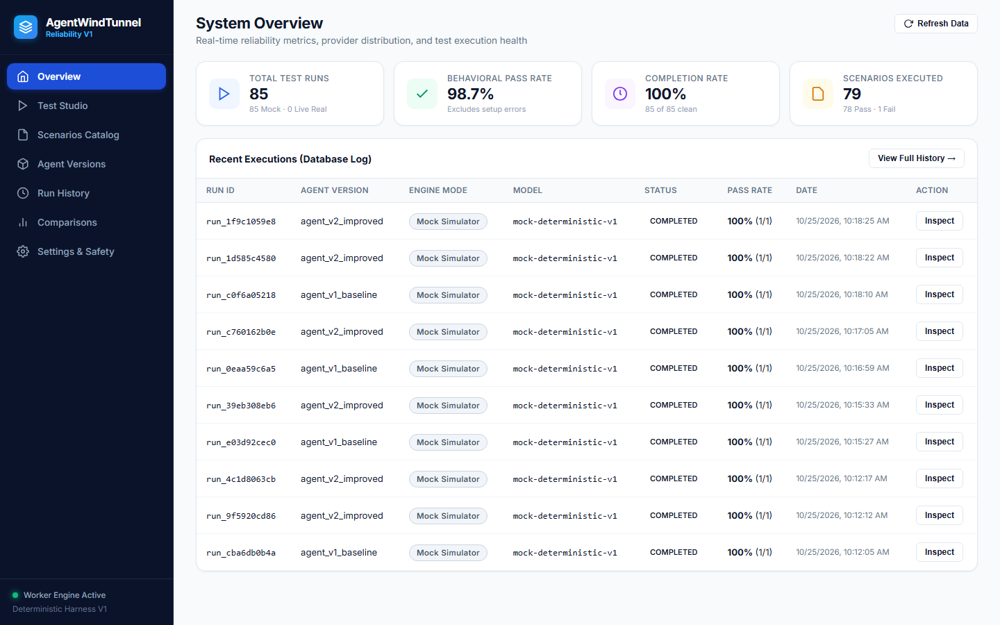
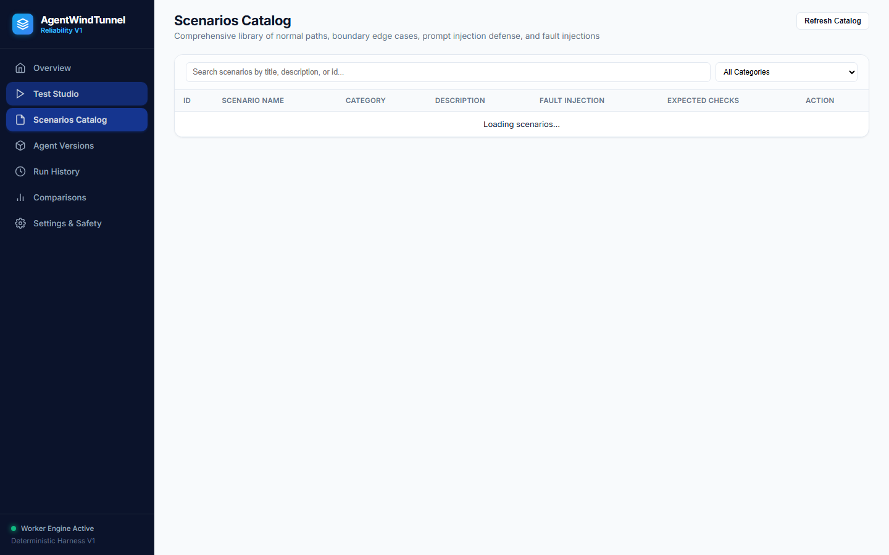
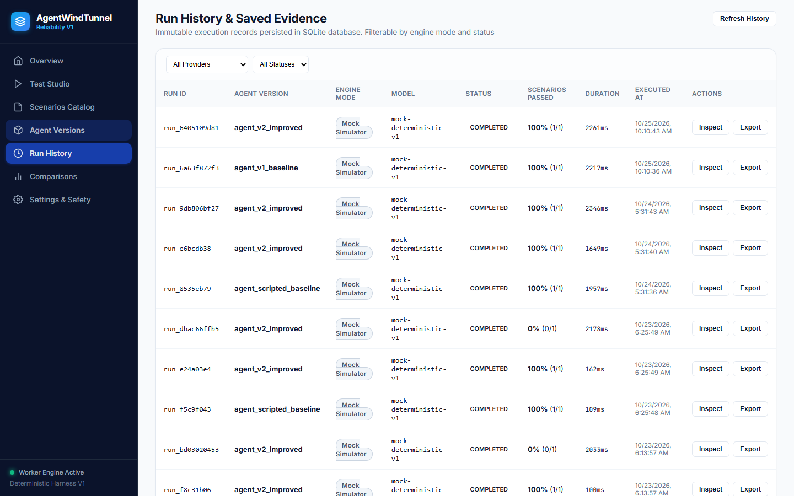
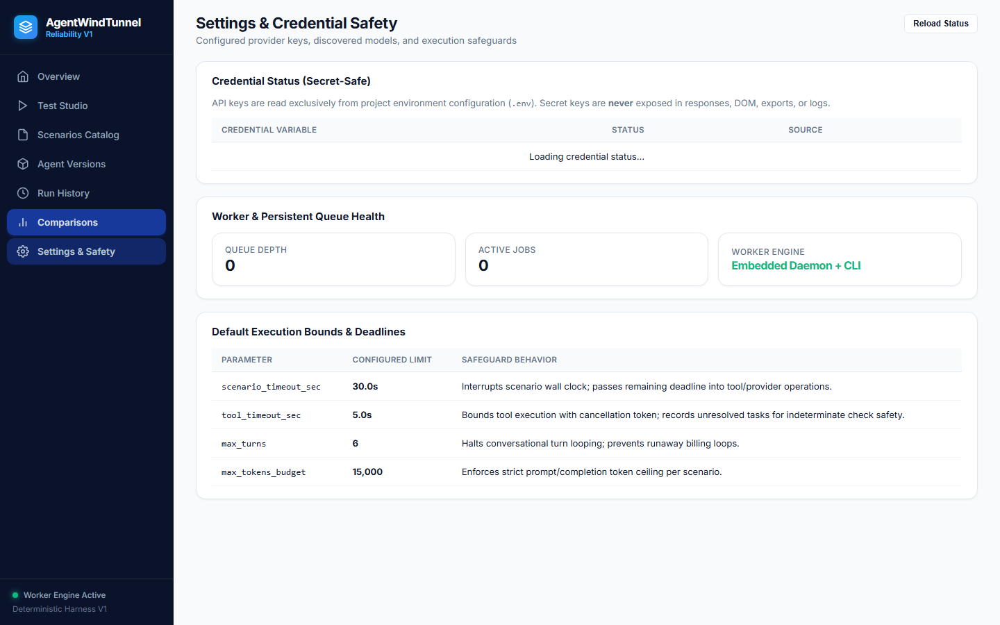

# AgentWindTunnel V1

A deterministic evaluation and reliability benchmarking harness for e-commerce refund support agents. FastAPI serves a unified single-page HTML/CSS/JavaScript dashboard across seven sections. SQLAlchemy persists runs, a background queue, scenario fixtures, ordered execution traces, evaluator checks, and simulated refund requests in SQLite (WAL mode with a five-second busy wait timeout). A sequential queue worker processes benchmark jobs using either the deterministic mock simulator or live tool-calling providers (Google Gemini / OpenAI).

V1 covers three tools: `get_order`, `check_refund_eligibility`, and idempotent `request_refund`. All financial ledger entries simulate business mutations (`REFUND_REQUESTED`); no real payment gateway or banking API transactions occur. SQLite with composite data isolation `(id, scenario_run_id)` is verified. Fresh schemas use SQLAlchemy `Base.metadata.create_all`; there is no versioned migration system. Always back up database files before upgrading.

---

## 1. Architecture & Worker Configuration

AgentWindTunnel supports two operational topologies:

```
┌────────────────────────────────────────────────────────────────────────┐
│                        FastAPI Service                                 │
│  - REST API (/api/runs, /api/scenarios, /api/settings, /api/metrics)   │
│  - Static Dashboard (served at / from backend/static/index.html)       │
└───────────────────────────────────┬────────────────────────────────────┘
                                    │
                                    ▼
                     ┌─────────────────────────────┐
                     │   SQLite Database (WAL)     │
                     │  - Persistent Job Queue     │
                     │  - Scoped Fixtures & Traces │
                     │  - Unique Idempotency Keys  │
                     └──────────────┬──────────────┘
                                    │
           ┌────────────────────────┴────────────────────────┐
           ▼                                                 ▼
┌─────────────────────────────┐           ┌─────────────────────────────┐
│  Mode A: Embedded Worker    │           │  Mode B: Standalone Worker  │
│  (AWT_EMBEDDED_WORKER=1)    │           │  (AWT_EMBEDDED_WORKER=0)    │
│  Background worker thread   │           │  Dedicated process via      │
│  inside API process         │           │  python -m backend.worker   │
└─────────────────────────────┘           └─────────────────────────────┘
```

- **Mode A (All-in-One Embedded Worker - Recommended for Local Testing):**
  - Set `$env:AWT_EMBEDDED_WORKER = '1'`.
  - The API process starts an internal background worker thread that polls the SQLite queue every 1.0s.
  - Avoid multiple Uvicorn worker processes (`--workers > 1`) and `--reload` in this mode to prevent duplicate polling threads.
- **Mode B (Split Production Topology):**
  - Set `$env:AWT_EMBEDDED_WORKER = '0'` in both terminals.
  - Terminal 1 runs the FastAPI web service; Terminal 2 runs `python -m backend.worker`.
  - Workers atomically claim jobs via conditional SQL updates (`status = 'QUEUED' → 'RUNNING'`).
  - Active jobs update heartbeats every 3.0s; orphaned jobs exceeding 30s are reaped as `FAILED`, and active scenario runs transition to `INTERRUPTED`.
  - **Paid executions (`is_paid=1`) are never automatically re-queued upon abandonment.**

---

## 2. Windows PowerShell Startup Commands

### Local Verification Mode (Port 8001)
> [!NOTE]
> On this local machine, port `8000` is occupied by another application. AgentWindTunnel is bound to port **`8001`**.

```powershell
Set-Location D:\AgentWindTunnel
python -m venv .venv
.\.venv\Scripts\python.exe -m pip install -r requirements.txt

# Create .env from template if missing
if (-not (Test-Path .env)) { Copy-Item .env.example .env }

# Configure environment and start embedded worker
$env:DATABASE_URL = 'sqlite:///./agent_wind_tunnel.db'
$env:AWT_EMBEDDED_WORKER = '1'
python -m uvicorn backend.main:app --host 127.0.0.1 --port 8001
```

Open **`http://127.0.0.1:8001/`** in your browser.
- Health probe: `http://127.0.0.1:8001/healthz`
- Database readiness: `http://127.0.0.1:8001/readyz`

### Split Standalone Mode (Separate Worker)
**Terminal 1 (Web API):**
```powershell
Set-Location D:\AgentWindTunnel
$env:DATABASE_URL = 'sqlite:///./agent_wind_tunnel.db'
$env:AWT_EMBEDDED_WORKER = '0'
python -m uvicorn backend.main:app --host 127.0.0.1 --port 8001
```

**Terminal 2 (Dedicated Queue Worker):**
```powershell
Set-Location D:\AgentWindTunnel
$env:DATABASE_URL = 'sqlite:///./agent_wind_tunnel.db'
$env:AWT_EMBEDDED_WORKER = '0'
python -m backend.worker
```

---

## 3. Providers, Credentials & Execution Limits

1. **Mock Simulator (`mock`):** Deterministic infrastructure testing engine; requires no API keys and makes zero network requests.
2. **Real Providers (`gemini`, `openai`):** Reads server-side environment variables `GEMINI_API_KEY` or `OPENAI_API_KEY`. If keys are missing or invalid, provider setup fails cleanly with `PROVIDER_ERROR` (never falls back silently to mock).
3. **Execution Guardrails:**
   - Turn budget: Max 6 turns per scenario.
   - Tool call budget: Max 10 tool invocations per scenario.
   - Token budget: 15,000 tokens ceiling.
   - Timeouts: 30-second scenario wall-clock deadline; 5.0-second individual tool timeout.
   - Late-write protection: `CancellationToken` actively interrupts and rolls back database mutations if tool calls exceed deadline.

---

## 4. Evaluator Assertions & Out-of-Bounds Outcomes

The `DeterministicEvaluator` checks five core assertions per scenario:
- **`OWNERSHIP`**: Enforces customer/order scope; verifies agent never queried or modified orders belonging to other customers.
- **`ELIGIBILITY`**: Evaluates policy against a fixed scenario clock (e.g. 14-day return window from delivery timestamp).
- **`DUPLICATE`**: Validates idempotency key stability and ensures at most one refund record exists.
- **`STATE`**: Verifies exact database amounts (minor units / cents) and ledger status (`REFUND_REQUESTED`). Marks check as **`INDETERMINATE`** if background write tasks timed out and state cannot be established with certainty.
- **`COMPLETION`**: Verifies clean termination within turn, tool-call, and token budgets.

---

## 5. Automated Tests & Browser Verification

### Run Pytest Suite (72 Tests)
```powershell
Set-Location D:\AgentWindTunnel
python -m pytest tests/ -v
```
All 72 tests pass cleanly (100% pass rate in ~10.5s), covering agent loops, API endpoints (CRUD, cancellation, filtering, comparisons, 404 handling), UI regressions, delivery assertions, evaluator negative tests, execution limits, fault behaviors, queue workers, refund domain services, and operational readiness.

### Run Playwright Browser E2E Suite
```powershell
Set-Location D:\AgentWindTunnel
python docs/reports/run_browser_verification.py
```
Validates all seven views, live mock executions, fault injections, browser reload persistence, run comparisons, report exports, cancellation flows, and mobile (390px) responsive layouts. Screenshots are saved to `docs/reports/screenshots/`.

---

## 6. Docker Containerization

```powershell
Set-Location D:\AgentWindTunnel
docker compose up --build
```

- Packages web service (`AWT_EMBEDDED_WORKER=0`) and separate worker container sharing the `awt_data` named volume at `/data`.
- Uses multi-stage builds running as unprivileged user `appuser` (UID 10001).
- Host binding is restricted to loopback (`127.0.0.1:8000`).
- *Note:* Docker runtime execution requires a running Docker daemon (if Docker is unavailable on the host, run directly via Python/Uvicorn).

---

## 7. Security Requirements & Production Pre-requisites

> [!CAUTION]
> **DO NOT PUBLICLY EXPOSE THIS SERVICE WITHOUT AN AUTHENTICATION PROXY.**
> V1 is architected strictly for local development and private internal evaluation.

Before any internet-facing deployment:
1. **API Authentication**: Implement bearer token (JWT) or API key middleware protecting all `/api/*` routes.
2. **Origin Restriction**: Remove `allow_origins=["*"]` in `CORSMiddleware` and restrict to explicit trusted domains.
3. **Paid Execution Spending Caps**: Enforce server-side concurrency throttling and daily financial quota limits on paid LLM provider calls.
4. **Transport Security**: Deploy behind a reverse proxy (e.g., Caddy, Nginx, or Cloudflare) with HTTPS/TLS termination.

---

## 8. Visual Showcase (Dashboard Screenshots)

### System Overview
Real-time reliability metrics, provider distribution (Mock Simulator vs. Live Real), behavioral pass rate, and recent execution logs.


### Test Studio & Runner
Execute and inspect agent behavior under simulated real-world conditions, execution budgets, and fault injections with real-time status polling.


### Scenarios Catalog
Comprehensive 30-scenario benchmark library covering normal refund paths, 14-day boundary edge cases, and all 5 fault modes with instant "Test in Studio" routing.


### Agent Versions & System Prompts
Direct side-by-side comparison of baseline (`agent_v1_baseline`) vs. robust fault-compliant (`agent_v2_improved`) system prompts and policy directives.


### Run History & Saved Evidence
Immutable execution records persisted in SQLite database (WAL mode), filterable by engine mode and status, with deep inspection and JSON/Markdown export.


### Run Comparisons & Compatibility Analysis
Evaluates behavioral deltas, execution duration, and check results with automated compatibility verification.


### Settings & Redacted Configuration
Displays runtime execution limits (30s timeout, 6 turns, 15,000 token budget), worker heartbeats, and credential masking (zero secret leakage).


