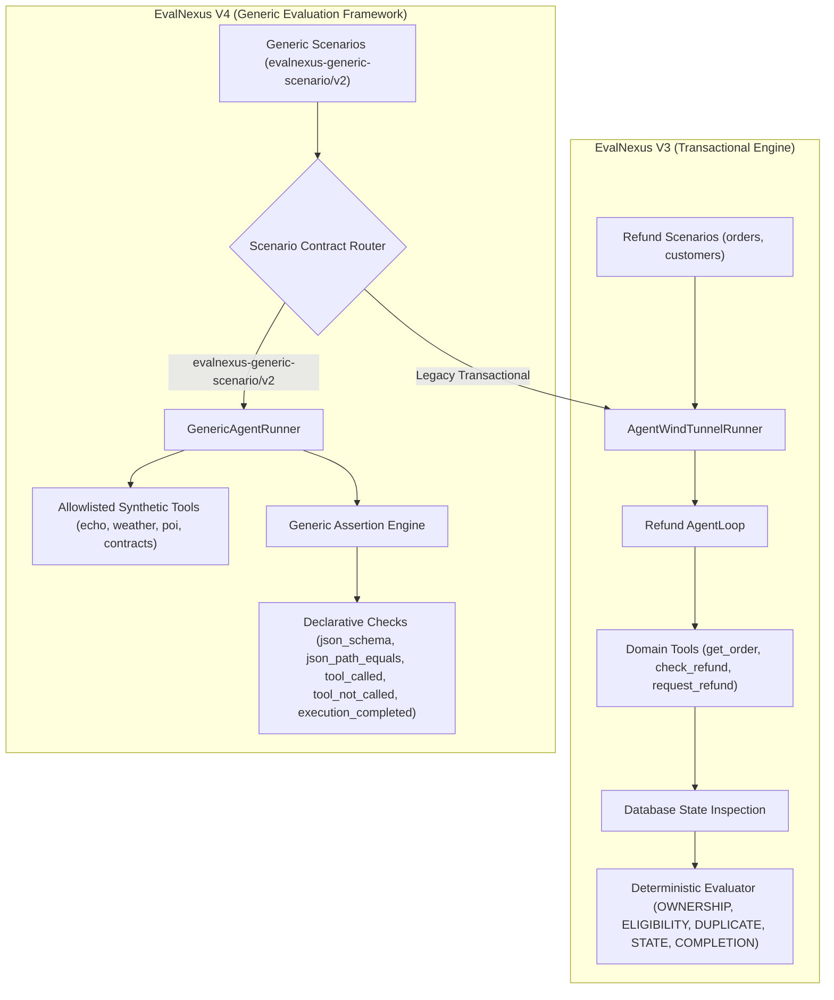

# EvalNexus V4: Generic AI Agent Evaluation Architecture

## 1. Executive Summary

EvalNexus V4 upgrades the platform from a specialized e-commerce transactional testing harness into a **Domain-Agnostic AI Agent Evaluation Framework**. EvalNexus V4 enables evaluation of autonomous AI agents across diverse domains (Sentiment Analysis, Autonomous Travel Planning, Financial Auditing, Customer Support, etc.) while maintaining **100% backward compatibility** with existing transactional refund scenarios, mock simulation, and historical Qwen2.5-1.5B-Instruct Colab GPU evaluation evidence.

---

## 2. Architecture Comparison: V3 vs. V4

---

## 3. Core Architectural Components

### 3.1 Versioned Scenario Contract (`evalnexus-generic-scenario/v2`)
Generic scenarios define declarative inputs, allowlisted tool contracts, and assertions without hardcoded database fixtures:
- `schema_version`: `"evalnexus-generic-scenario/v2"`
- `domain`: Arbitrary string (e.g., `sentiment`, `travel`, `finance`, `support`)
- `evaluation_mode`: `"GENERIC"`
- `input`: Flexible input payload dictionary
- `customer_messages`: Conversation turns provided to the agent
- `tool_contracts`: List of allowed/expected tool definitions
- `assertions`: List of declarative evaluation assertions
- `execution_limits`: Turn limits, tool call caps, token budgets, and timeout seconds

### 3.2 Generic Assertion Engine (`backend/runner/generic_evaluator.py`)
Evaluates executions fail-closed:
1. `json_schema`: Validates agent structured output against JSON Schema draft-07/2020-12 using `jsonschema`.
2. `json_path_equals`: Safe JSONPath extraction supporting dot and array bracket notation (`$.sentiment`, `itinerary.days[0].activity`), checking exact or case-insensitive equality.
3. `tool_called`: Confirms required tool execution from sequential DB trace logs, optionally verifying specific argument subsets.
4. `tool_not_called`: Strict negative safety assertion ensuring prohibited tools (e.g. `unauthorized_booking`, `delete_account`) were never executed.
5. `execution_completed`: Verifies clean termination without timeouts, rate limits, or unhandled exceptions.

### 3.3 Safe Tool Containment & Generic Runner (`backend/runner/generic_runner.py`)
- Executes agents across `Mock`, `Custom HTTP`, `OpenAI`, `Gemini`, or `Colab Offline` providers.
- Allowlisted synthetic tool executor with zero host filesystem access or arbitrary execution:
  - `echo_tool`: Diagnostic testing.
  - `check_weather`: Deterministic weather conditions.
  - `lookup_poi`: Verified points of interest.
  - Custom stub contracts defined in the scenario.
- Prohibited tool calls are intercepted, quarantined, and recorded as `UNAUTHORIZED_TOOL_CALL` trace events.

### 3.4 Google Colab Pro + Tesla T4 GPU Generic Runner
- `EvalNexus_Colab_LLM.ipynb` (Step 14) executes generic scenario bundles on local open-source models (`Qwen/Qwen2.5-1.5B-Instruct`).
- Exports audited result bundles (`evalnexus-generic-run-result/v2`) for offline import back to local dashboards.

---

## 4. Security & Isolation Guarantees

| Attack Vector | Defense Mechanism | Verified In |
| :--- | :--- | :--- |
| **Path Traversal in IDs** | Strict regex validation (`^[a-zA-Z0-9_\-]+$`), rejects `..`, `/`, `\` | `test_generic_scenarios.py` |
| **SSRF via Custom Agents** | Hostname denylist (`metadata.google.internal`), link-local IP blocking | `test_security_hardening.py` |
| **Arbitrary Code Execution** | No `eval()`, `exec()`, or shell commands in tool handlers | Static & runtime verification |
| **Denial of Service** | 500KB scenario size limit, hard timeout enforcement | `test_custom_scenario_builder.py` |
| **Prohibited Tool Invocations**| Containment intercepts unauthorized tools, fails safety assertions | `test_generic_evaluator.py` |

