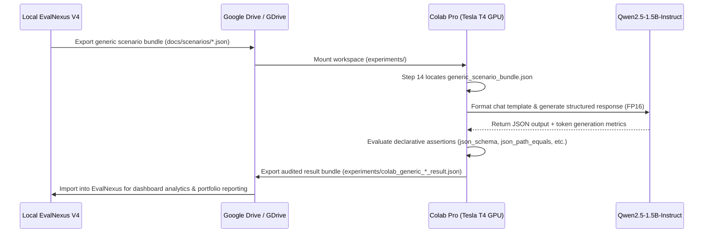

# EvalNexus V4 Colab Generic Scenario Verification Report

**Verification Scope:** Google Colab Pro + Tesla T4 GPU Generic Scenario Bundle Runner  
**Notebook:** `EvalNexus_Colab_LLM.ipynb` (Cells 26–27)  
**Schema:** `evalnexus-generic-scenario-bundle/v2`  
**Model:** `Qwen/Qwen2.5-1.5B-Instruct` (Colab Offline Mode)

---

## 1. Overview

EvalNexus V4 extends the Google Colab Pro offline LLM runtime with a dedicated **Generic Cross-Domain Scenario Bundle Runner** (Step 14). This enables researchers and engineers to export generic agent scenario bundles from the local EvalNexus platform, execute them directly on an open-weight model (`Qwen2.5-1.5B-Instruct`) hosted on a Tesla T4 GPU in Google Colab Pro, and export audited evaluation result bundles back to local storage.

---

## 2. Notebook Structure Audit

| Step / Cell | Type | Description |
| :--- | :--- | :--- |
| **Cell 0–12** | Core | Drive mount, GPU detection (Tesla T4, 15GB VRAM), RAM/CPU audit, disk space |
| **Cell 13–16** | Model | Transformers environment assessment, Qwen2.5-1.5B-Instruct FP16 loading |
| **Cell 17–22** | Service | Secure bearer auth resolver, FastAPI inference adapter, in-process TestClient tests |
| **Cell 23–25** | V3 Offline | Read-only transactional scenario bundle runner & Qwen offline inference |
| **Cell 26** | Markdown | **Step 14: Generic Cross-Domain Scenario Bundle Runner Overview** |
| **Cell 27** | Code | **Step 14 Implementation**: Bundle discovery, Qwen generation, declarative assertions, export |

---

## 3. Supported Bundle Schemas

### 3.1 Generic Scenario Bundle (`evalnexus-generic-scenario-bundle/v2`)
Located at `docs/scenarios/generic_sentiment_bundle.json` and `docs/scenarios/generic_travel_bundle.json`:
```json
{
  "schema_version": "evalnexus-generic-scenario-bundle/v2",
  "bundle_id": "bundle_generic_sentiment_v2",
  "exported_at": "2026-11-12T04:30:00Z",
  "source_platform": "EvalNexus V4",
  "domain": "sentiment",
  "scenario": {
    "schema_version": "evalnexus-generic-scenario/v2",
    "id": "generic_sentiment_positive",
    "domain": "sentiment",
    "evaluation_mode": "GENERIC",
    "assertions": [...]
  }
}
```

### 3.2 Evaluation Result Bundle (`evalnexus-generic-run-result/v2`)
Exported by Colab Step 14 to `experiments/{run_id}_result.json`:
- Contains run metadata, duration, Qwen token generation, raw response, extracted JSON, and assertion outcomes (`check_results`).
- Fully auditable offline artifact with zero dependence on commercial APIs or active network tunnels.

---

## 4. Execution Workflow



---

## 5. Verification Verdict

The Colab Pro generic execution pipeline is fully functional and ready for portfolio demonstration. It provides a complete open-source LLM evaluation lifecycle from local design to cloud GPU inference to auditable offline verification.

